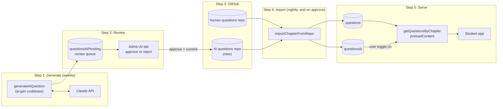
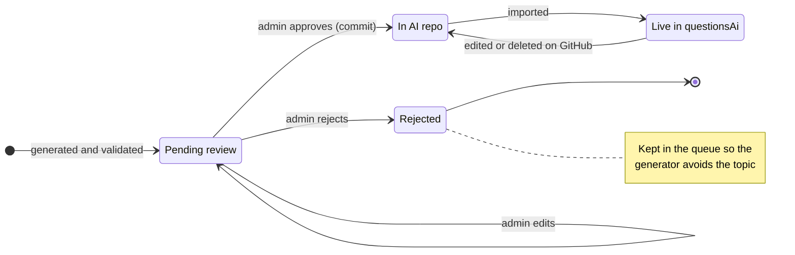
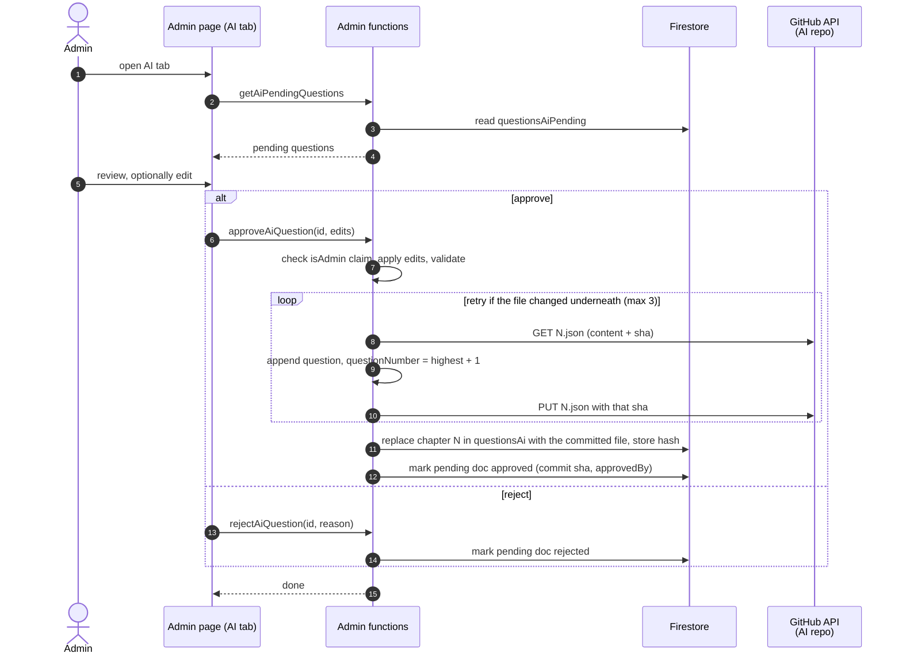
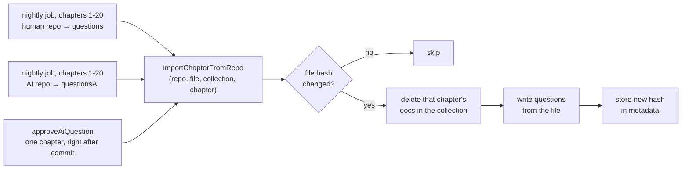
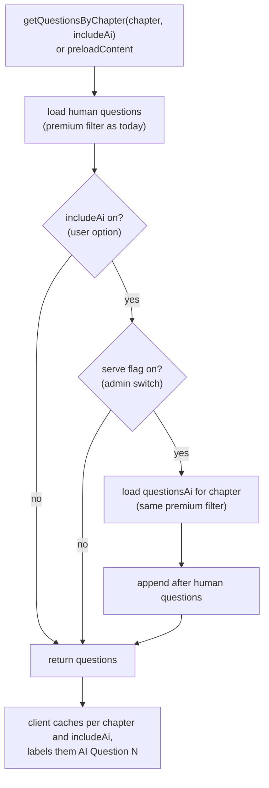

# AI question flow (proposed)

> **Status:** draft design, not built.
>
> The generator half lives in `real-estate-quest-ai-gen` → `docs/ai-question-flow.md` on the `docs/ai-question-flow` branch. The overview and lifecycle diagrams are the same in both repos.

## Principles

- **Repos are the source of truth for anything students see.** Firestore is a copy that can be rebuilt from the repos at any time.
- **`questionsAiPending` is a disposable review queue.** Losing it costs a regeneration, nothing more.
- **AI questions never go into `questions`.** The nightly human import deletes and reimports whole chapters, so anything else in that collection would be wiped.
- **The human questions repo stays read-only everywhere.** Only the new AI repo gets a write token.

## Where things live

There is **one Firebase project**, the existing `real-estate-quest`. There is no separate AI project; the generator, the app, and every collection below live in it.

| | What | Notes |
|---|---|---|
| Firebase project | `real-estate-quest` | The only one. Runs the app, all functions, and Firestore. |
| Functions | `default` codebase from the `real-estate-quest` repo `ai-gen` codebase from the `real-estate-quest-ai-gen` repo | Two repos deploy into the same project. Deploying one never touches the other's functions. |
| Firestore | `questions` (existing), `questionsAi`, `questionsAiPending`, `metadata/aiQuestions` | All in the same database, so no credentials are needed between pieces. |
| GitHub | `real-estate-quest-questions` (existing, human) `real-estate-quest-ai-questions` (new, AI) | Both private. The source of truth for anything students see. |
| External | Claude API | Called only by the generator. |

## Overview

The generator also reads `questions` (few-shot examples) and `questionsAi` (to avoid duplicates); see the generation diagram.

## Question lifecycle

## Review and approve (this repo)

## Nightly import (this repo)

The existing nightly job imports both repos through one shared function, so no new Cloud Scheduler job is needed.

`approveAiQuestion` already has the committed file in hand, so it can skip the fetch and go straight to the replace step.

## Serving (this repo)

Every AI question is `premium: true`, so free users never get them whatever the toggle says.

## Changes in this repo

**Functions** ([functions/index.js](../functions/index.js))

- [ ] Pull the body of `importQuestionsFromRepo` into `importChapterFromRepo(repo, file, collection, chapter)` and have the nightly job call it for both repos.
- [ ] New secrets: a fine-grained GitHub token with contents read/write on the AI repo only, plus the AI repo name. The existing `GITHUB_TOKEN` stays read-only.
- [ ] Admin-only callables, checking the `isAdmin` claim like the existing admin functions: `getAiPendingQuestions`, `approveAiQuestion`, `rejectAiQuestion`, `updateAiSettings` (the `generate` and `serve` flags).
- [ ] `getQuestionsByChapter` and `preloadContent`: accept `includeAi`, check `metadata/aiQuestions.serve`, merge.
- [ ] Give `questionsAi` the same composite indexes `questions` uses (chapter + premium + questionNumber).
- [ ] Make sure Firestore rules deny direct client access to `questionsAiPending` and `questionsAi`; everything goes through functions.

**Frontend**

- [ ] Admin page ([admin.vue](../src/components/admin.vue), [useAdmin.js](../src/composables/useAdmin.js)): AI tab with the pending list, an edit form, approve/reject, the generate/serve switches, and a Generate now button.
- [ ] Options modal ([optionModal.vue](../src/components/optionModal.vue)): an "Include AI-generated questions" switch next to "shuffled". Changing it clears the question cache.
- [ ] [useQuestion.js](../src/composables/useQuestion.js) and [usePreload.js](../src/composables/usePreload.js): pass `includeAi` and include it in the cache key.
- [ ] [questionCard.vue](../src/components/questionCard.vue): show "AI Question N" (or a badge) instead of "Question N", so numbers don't clash with human questions.
- [ ] [useActivityTracker.js](../src/composables/useActivityTracker.js): record `aiGenerated` so stats don't merge AI question 3 with human question 3.
- [ ] Tests for the new composable behaviour in `tests/composables/`.

## Open questions

- Should the toggle default to on or off for pro users?
- Mix AI questions into each chapter (as drawn above), or offer them as a separate practice set?
- Delete rejected questions after a while, or keep them forever for duplicate avoidance?
