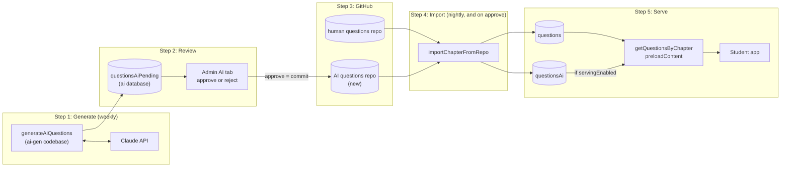
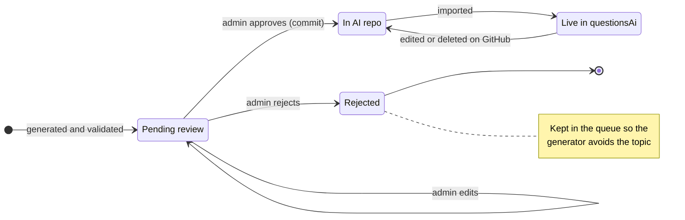
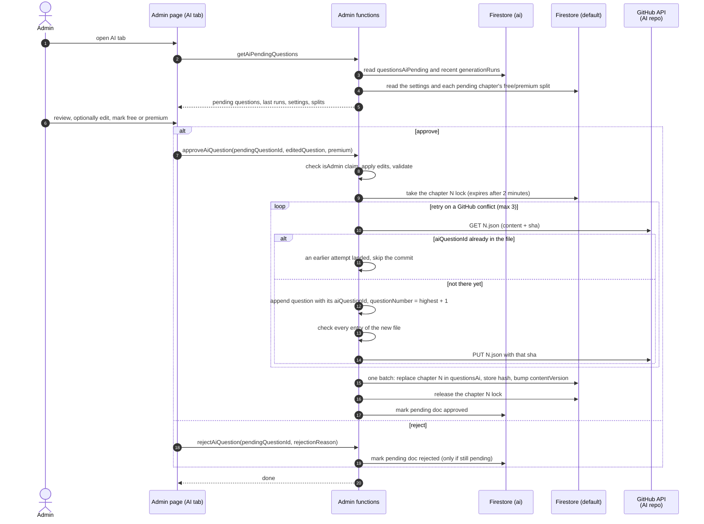
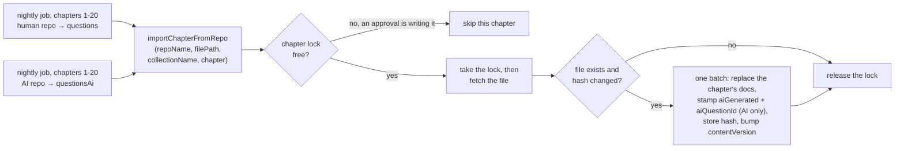
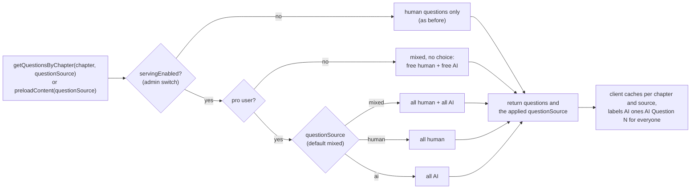

# AI question flow

> **Status:** built on branch `feature/ai-question-flow`, not deployed yet.
>
> The generator half lives in `real-estate-quest-ai-gen` → `docs/ai-question-flow.md`. The principles, where things live, overview and lifecycle sections are the same in both repos.

## Principles

- **Repos are the source of truth for anything students see.** Firestore is a copy that can be rebuilt from the repos at any time.
- **`questionsAiPending` is a disposable review queue.** Losing it costs a regeneration, nothing more.
- **AI questions never go into `questions`.** The nightly human import deletes and reimports whole chapters, so anything else in that collection would be wiped.
- **The human questions repo stays read-only everywhere.** Only the new AI repo gets a write token.
- **The generator can only write to its own database.** It runs as its own service account, which can write the `ai` database and only read `(default)`. A bug in the generator can't change user data, subscriptions or live questions.

## Where things live

There is **one Firebase project**, the existing `real-estate-quest`. There is no separate AI project; the generator, the app, and every collection below live in it. The project has two Firestore databases: `(default)`, which exists today, and a new `ai` one.

| | What | Notes |
|---|---|---|
| Firebase project | `real-estate-quest` | The only one. Runs the app, all functions, and both Firestore databases. |
| Functions | `default` codebase from the `real-estate-quest` repo `ai-gen` codebase from the `real-estate-quest-ai-gen` repo | Two repos deploy into the same project. Deploying one never touches the other's functions. |
| Firestore `(default)` | Everything that exists today (`members`, `questions`, `flashcards`, `study_activity_logs`, ...), plus `questionsAi`, `metadata/aiQuestions` (`generationEnabled`, `servingEnabled`, `questionsPerRun`), `metadata/content` (`contentVersion`), `metadata/questionsAi` (AI file hashes), `locks/*` (per-chapter locks) | User data lives here. Point-in-time recovery plus the existing weekly backups. |
| Firestore `ai` (new) | `questionsAiPending` (review queue), `generationRuns` (one doc per run, with any error), `locks/generation` | Everything the generator writes, and nothing else. Disposable, so no point-in-time recovery or backups. |
| Service accounts | `ai-gen` (new) runs the `ai-gen` functions The app's functions keep the default one | See Access below. |
| GitHub | `real-estate-quest-questions` (existing, human) `real-estate-quest-ai-questions` (new, AI) | Both private. The source of truth for anything students see. |
| External | Claude API | Called only by the generator. |

### Access

Firestore can't limit server code to certain collections. Security rules work per collection, but they only apply to web and mobile clients; the Admin SDK that Cloud Functions use skips them. IAM does apply to functions, but the smallest thing it can scope to is a whole database. So everything the generator writes goes in its own database, and IAM keeps it there.

| Service account | `(default)` | `ai` |
|---|---|---|
| `ai-gen` (the generator) | read only (`roles/datastore.viewer`) | read and write (`roles/datastore.user`) |
| Default (the app's functions) | read and write | read and write |

- **Each `ai-gen` grant has an IAM condition naming its database,** such as `resource.name == "projects/real-estate-quest/databases/ai"`. A grant without a condition covers every database in the project, which is why the app's functions can already reach both.
- **`ai-gen` also gets the Anthropic key secret, and nothing else.** No GitHub tokens, no Stripe keys.
- **The generator can still read user data in `(default)`.** It can't change or delete it.
- **No keys are involved.** Both databases are in one project, so access is plain IAM.

## Overview

Everything outside Step 1 is in `(default)` except `questionsAiPending`. The generator also reads `questions` (chapter context) and `questionsAi` (to avoid duplicates) from `(default)`, read only; see the generation diagram.

## Question lifecycle

## Review and approve (this repo)

- **Safe to retry.** Every AI question carries a stable `aiQuestionId` (its pending doc's id) into the repo file. Say a commit lands but the function dies before updating Firestore, or the admin clicks Approve twice. The next attempt finds the `aiQuestionId` already in the file, skips the commit, and only finishes the Firestore step. Nothing is ever appended twice.
- **The whole new file is checked before the commit.** Every entry gets the shape checks the nightly import applies; the full validation rules apply only to the question being approved. A bad entry already in the file, say from a hand edit on GitHub, blocks approvals in that chapter with a `failed-precondition` error naming the entry, until it's fixed on GitHub.
- **One writer per chapter.** Approval and import both hold the chapter's lock (a Firestore doc that expires on its own) while they read from GitHub and write `questionsAi`. A slow nightly import can't write an older copy of the file over a newer approval, and two approvals in the same chapter run one after the other instead of racing.
- **All-or-nothing writes.** The chapter's documents, its hash and `contentVersion` go in one batch, so students never see a half-empty chapter. The old import deleted and re-added in two separate batches.
- **The pending doc is marked approved last,** as its own write, because a batch can't span two databases. If that write fails, the question is already live, and approving again finishes the job (the `aiQuestionId` check skips the commit).

## Nightly import (this repo)

The existing nightly job (`importQuestionsFromRepo`) imports both repos through one shared function, so no new Cloud Scheduler job is needed.

- **The fetch happens after taking the lock,** so the import always writes the newest file, never one it read before an approval landed.
- **Skipping a locked chapter is safe.** The approval holding the lock is already writing the newest version.
- **`approveAiQuestion` writes the chapter itself** from the file it just committed, while it still holds the lock, so it doesn't wait for the nightly run.
- **The importer stamps `aiGenerated: true` and the chapter** on every `questionsAi` doc itself, rather than trusting whatever is in the file. Each doc keeps its entry's `aiQuestionId`; a question added by hand on GitHub without one gets `chapter<N>_question<questionNumber>`, and one without `premium` is premium.
- **An AI file with a bad entry isn't imported.** The nightly job logs the error, which names the entry, to `function_error_logs`, and the chapter keeps its live questions until the file is fixed on GitHub.
- **Deleting a chapter file on GitHub doesn't remove that chapter's live AI questions.** A missing file is skipped, like in the human import. To remove them all, commit `[]` to the file.

## Serving (this repo)

- **Pro users** choose Mixed (the default), Human only, or AI only. **Free users** get no choice: the free AI questions are simply mixed in.
- **Mixed** means AI questions come after the human ones; the existing shuffle option mixes them together.
- **Free vs premium** follows the human questions: the reviewer marks each AI question free or premium at approval, premium by default. Today 52 of the 940 human questions are free (about 1 in 18), from 1 in 4 in chapters 2–3 to 1 in 80 in chapters 18–19.
- **AI questions keep their identity end to end.** `getQuestionsByChapter` returns `aiGenerated` and `aiQuestionId` with each AI question, and the activity log stores them. Without that, AI question 3 and human question 3 in a chapter look identical in the logs.

### Turning serving off, and the browser cache

The browser caches each chapter's questions for 24 hours (`STALE_TIME`), and a cached chapter never calls the server. On its own, the serving switch (`servingEnabled`) would take up to a day to reach users.

- **On load, the app calls a small `getContentStatus` callable** that returns `contentVersion` and `aiQuestionsServed`. If `contentVersion` differs from the cached one, the app clears its cached questions and flashcards (saved options stay). It runs once per page load, before the preload; if it fails, the cache is kept and AI questions stay hidden.
- **`contentVersion` changes** whenever `servingEnabled` changes, a question is approved, or an import changes a chapter. So turning serving off takes effect on each user's next page load.
- **`aiQuestionsServed` drives the options modal**, which shows the source choice only when it's on. While it's off, a saved "AI only" choice gets human questions, and the server returns human questions only whatever the client asks for.
- **Side benefit:** edits to human questions stop taking up to a day to show up.

## Changes in this repo

**Functions** ([functions/index.js](../functions/index.js), with the pure helpers in [functions/aiQuestions.js](../functions/aiQuestions.js) and their tests in `functions/test/`)

- [x] Pull the body of `importQuestionsFromRepo` into `importChapterFromRepo({repoOwner, repoName, repoToken, filePath, collectionName, chapter, isAiRepo})` and have the nightly job call it for both repos. It takes the chapter lock before fetching, writes in one batch, stamps `aiGenerated` and `aiQuestionId` on AI docs, and bumps `contentVersion` when a chapter changes.
- [x] New secrets: `AI_QUESTIONS_GITHUB_TOKEN`, a fine-grained GitHub token with contents read/write on the AI repo only, and `AI_QUESTIONS_GITHUB_REPO`, the AI repo's name (its owner is the existing `GITHUB_USERNAME`). The AI repo's files are `<chapter>.json`. The existing `GITHUB_TOKEN` stays read-only.
- [ ] Create the AI repo and its token on GitHub, then set both secrets with `firebase functions:secrets:set` before the first deploy.
- [x] Admin-only callables, checking the `isAdmin` claim like the existing admin functions: `getAiPendingQuestions`, `approveAiQuestion`, `rejectAiQuestion`, `updateAiSettings` (the `generationEnabled` and `servingEnabled` switches, and `questionsPerRun`, the number of questions per weekly run). `approveAiQuestion` holds the chapter lock, skips the commit if the `aiQuestionId` is already in the file, and checks every entry of the new file before committing. Changing `servingEnabled` bumps `contentVersion`.
- [x] A second Firestore client for the `ai` database (`getFirestore(admin.app(), "ai")`), used for `questionsAiPending` and `generationRuns`. The app's functions already have access to both databases. `getAiPendingQuestions` also returns the last 10 `generationRuns`.
- [x] `getContentStatus` callable returning `contentVersion` and `aiQuestionsServed`.
- [x] `getQuestionsByChapter` and `preloadContent`: accept `questionSource` (`mixed`, `human` or `ai`), honour it only for pro users (free users always get mixed), check `metadata/aiQuestions.servingEnabled`, merge, and return `aiGenerated` and `aiQuestionId` on AI questions, plus the `questionSource` they applied.
- [x] `logStudyActivity`: accept and store `aiGenerated` (boolean) and `aiQuestionId` (string, up to 64 characters). Its sanitizer keeps only a fixed list of fields, so anything new from the frontend has to be added there or it's silently dropped.
- [x] No new indexes: the new queries use only equality filters or a single-field order and sort in memory, so `questionsAi`, `questionsAiPending` and `generationRuns` need no composite indexes.
- [ ] Make sure the `(default)` rules deny direct client access to `questionsAi` and `locks`; everything goes through functions. Those rules aren't in this repo, so check them in the Firebase console. The `ai` database has its own deny-all rules, deployed from the ai-gen repo.

**Frontend**

- [x] Admin page ([admin.vue](../src/components/admin.vue), [useAdmin.js](../src/composables/useAdmin.js)): an AI Questions tab ([adminAiQuestions.vue](../src/components/adminAiQuestions.vue), with an [adminAiPendingQuestionCard.vue](../src/components/adminAiPendingQuestionCard.vue) per pending question) with the pending list, an edit form, a free/premium choice (premium by default, showing the chapter's current split), approve/reject, the `generationEnabled` and `servingEnabled` switches, `questionsPerRun`, recent generation runs with any errors, and a Generate now button that calls `generateAiQuestionsNow` (in the ai-gen codebase) and waits up to 30 minutes for it.
- [x] Options modal ([optionModal.vue](../src/components/optionModal.vue)): a "Question source" choice (Mixed / Human only / AI only, default Mixed) next to "shuffled", saved as the `questionSource` option ([useOption.js](../src/composables/useOption.js)). Shown only to pro users, and only while `aiQuestionsServed` is on. The cache is keyed by question source and chapter, so changing the source loads that source's cached questions rather than clearing the cache.
- [x] [useQuestion.js](../src/composables/useQuestion.js) and [usePreload.js](../src/composables/usePreload.js): pass `questionSource` and include it in the cache key (`questions_<questionSource>_<chapter>`). [useContentStatus.js](../src/composables/useContentStatus.js) calls `getContentStatus` once per page load, before the preload, and clears the cached content when `contentVersion` changes.
- [x] [questionCard.vue](../src/components/questionCard.vue): show "AI Question N" ("AI Question" when shuffled) for every user, so AI questions are always marked and numbers don't clash with human questions. AI-written text is HTML-escaped before it's rendered ([questionTextFormatting.js](../src/utils/questionTextFormatting.js)).
- [x] [useActivityTracker.js](../src/composables/useActivityTracker.js): send `aiGenerated` and `aiQuestionId` with each question event, so stats don't merge AI question 3 with human question 3. This only works together with the `logStudyActivity` change above.
- [x] Tests for the new composable behaviour in `tests/composables/`.

## Decisions

- **Who sees AI questions:** everyone, always labeled as AI. Pro users choose Mixed (default), Human only, or AI only; free users get them mixed in with no choice.
- **Free vs premium:** the same kind of split as human questions, chosen by the reviewer at approval, premium by default.
- **Volume:** 1–2 questions a week to start, likely 5–10 a week later. One chapter per week, using all of that chapter's questions as context.
- **Rejected questions:** kept, so the generator keeps avoiding those topics. Even at 5–10 a week, each chapter comes up about 2–3 times a year in the 20-week rotation, so it gains at most about 25 AI questions a year, so the context stays small. Revisit if it grows.
- **Notifications:** none. New questions just appear in the review queue on the admin page.
- **Generator access:** its own `ai` database and service account inside this project, not a separate project. It can write only to `ai` and only read `(default)`.
- **Backups:** point-in-time recovery on `(default)` alongside the weekly backups. The `ai` database needs neither.

## Deviations from the plan

- **Names:** `generate`, `serve` and `perRun` are `generationEnabled`, `servingEnabled` and `questionsPerRun`; `aiId` is `aiQuestionId`, `source` is `questionSource`, and `aiServe` is `aiQuestionsServed`.
- **No composite indexes:** `questionsAi` is queried with equality filters only and sorted in memory, instead of getting the indexes `questions` uses.
- **Changing the question source doesn't clear the cache,** since the cache key includes the source.
- **Every entry of an AI chapter file is checked,** by approval before it commits and by the nightly import. A bad entry blocks both for that chapter until it's fixed on GitHub.
