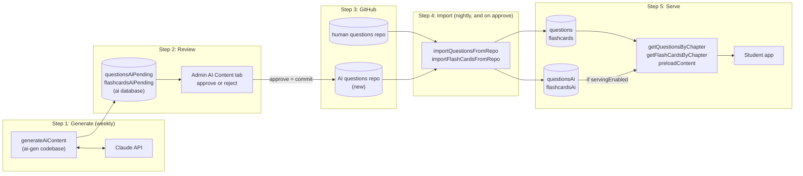
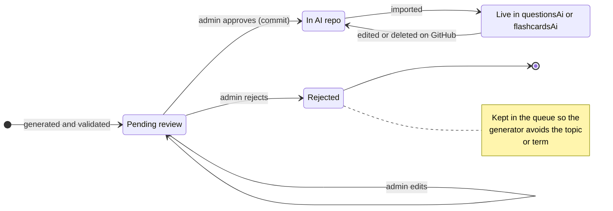
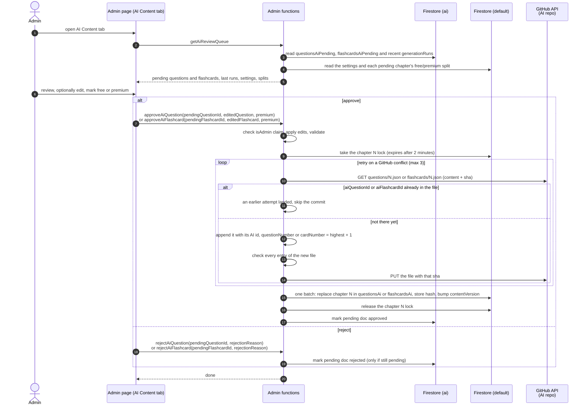
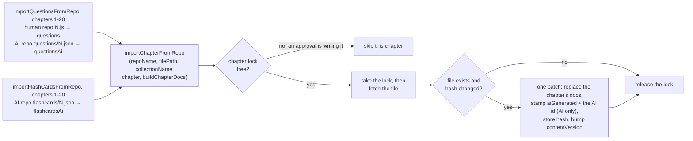
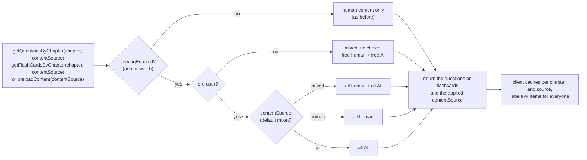

# AI question and flashcard flow

> **Status:** built on branch `feature/ai-question-flow`, not deployed yet. AI flashcards go through the same flow as AI questions, behind the same switches.
>
> The generator half lives in `real-estate-quest-ai-gen` → `docs/ai-question-flow.md`. The principles, where things live, overview and lifecycle sections are the same in both repos.

## Principles

- **Repos are the source of truth for anything students see.** Firestore is a copy that can be rebuilt from the repos at any time.
- **`questionsAiPending` and `flashcardsAiPending` are disposable review queues.** Losing them costs a regeneration, nothing more.
- **AI questions and flashcards never go into `questions` or `flashcards`.** The nightly human imports replace whole chapters of `questions` and all of `flashcards`, so anything else in those collections would be wiped.
- **The human questions repo stays read-only everywhere.** Only the new AI repo gets a write token.
- **The generator can only write to its own database.** It runs as its own service account, which can write the `ai` database and only read `(default)`. A bug in the generator can't change user data, subscriptions or live questions and flashcards.

## Where things live

There is **one Firebase project**, the existing `real-estate-quest`. There is no separate AI project; the generator, the app, and every collection below live in it. The project has two Firestore databases: `(default)`, which exists today, and a new `ai` one.

| | What | Notes |
|---|---|---|
| Firebase project | `real-estate-quest` | The only one. Runs the app, all functions, and both Firestore databases. |
| Functions | `default` codebase from the `real-estate-quest` repo `ai-gen` codebase from the `real-estate-quest-ai-gen` repo | Two repos deploy into the same project. Deploying one never touches the other's functions. |
| Firestore `(default)` | Everything that exists today (`members`, `questions`, `flashcards`, `study_activity_logs`, ...), plus `questionsAi` and `flashcardsAi` (live AI content), `metadata/aiContent` (`generationEnabled`, `servingEnabled`, `questionsPerRun`, `flashcardsPerRun`), `metadata/content` (`contentVersion`), `metadata/questionsAi` and `metadata/flashcardsAi` (AI file hashes), `locks/*` (per-chapter locks) | User data lives here. Point-in-time recovery plus the existing weekly backups. |
| Firestore `ai` (new) | `questionsAiPending` and `flashcardsAiPending` (review queues), `generationRuns` (one doc per run, with its content type and any error), `locks/generation` | Everything the generator writes, and nothing else. Disposable, so no point-in-time recovery or backups. |
| Service accounts | `ai-gen` (new) runs the `ai-gen` functions The app's functions keep the default one | See Access below. |
| GitHub | `real-estate-quest-questions` (existing, human) `real-estate-quest-ai-questions` (new, AI) | Both private. The source of truth for anything students see. The AI repo holds `questions/<chapter>.json` and `flashcards/<chapter>.json`. Each entry has the human files' fields in the same order, then `aiGenerated: true` and its AI id. Questions: `chapter`, `questionNumber`, `question`, `choices`, `correctChoice`, `premium`, `explanation`, `aiGenerated`, `aiQuestionId`. Flashcards (the human ones are a single `flashcards.js`): `documentID`, `cardNumber`, `front`, `back`, `chapter`, `tags`, `premium`, `difficulty`, `aiGenerated`, `aiFlashcardId`. |
| External | Claude API | Called only by the generator. |

### Access

Firestore can't limit server code to certain collections. Security rules work per collection, but they only apply to web and mobile clients; the Admin SDK that Cloud Functions use skips them. IAM does apply to functions, but the smallest thing it can scope to is a whole database. So everything the generator writes goes in its own database, and IAM keeps it there.

| Service account | `(default)` | `ai` |
|---|---|---|
| `ai-gen` (the generator) | read only (`roles/datastore.viewer`) | read and write (`roles/datastore.user`) |
| Default (the app's functions) | read and write | read and write |

- **Each `ai-gen` grant has an IAM condition naming its database,** such as `resource.name == "projects/real-estate-quest/databases/ai"`. A grant without a condition covers every database in the project, which is why the app's functions can already reach both.
- **`ai-gen` also gets the Anthropic key secret, and nothing else.** No GitHub tokens, no Stripe keys.
- **The generator can still read user data in `(default)`.** It can't change or delete it.
- **No keys are involved.** Both databases are in one project, so access is plain IAM.

## Overview

Every collection in the diagram is in `(default)` except the two review queues. The generator also reads the human and live AI questions and flashcards from `(default)`, read only, as context and to avoid duplicates; see the generation diagram.

## Question and flashcard lifecycle

## Review and approve (this repo)

- **One implementation for both.** `approveAiQuestion` and `approveAiFlashcard` share one approval (`approveAiItem`), and the two reject callables one rejection (`rejectAiItem`), set up per content type (`CONTENT_TYPES` in `functions/index.js`: collections, file path, id and number fields, validation). Everything below applies to both.
- **Safe to retry.** Every AI item carries a stable AI id (`aiQuestionId` or `aiFlashcardId`, its pending doc's id) into the repo file. Say a commit lands but the function dies before updating Firestore, or the admin clicks Approve twice. The next attempt finds the id already in the file, skips the commit, and only finishes the Firestore step, recording the entry as it is in the file. Nothing is ever appended twice.
- **The whole new file is checked before the commit.** Every entry gets the shape checks the nightly import applies; the full validation rules apply only to the item being approved. A bad entry already in the file, say from a hand edit on GitHub, blocks approvals into that file with a `failed-precondition` error naming the entry, until it's fixed on GitHub.
- **A flashcard gets the human cards' fields.** Approval appends it with a new `documentID` (a UUID, like every human card) and the next `cardNumber` in its AI chapter file. The card, with the reviewer's edits, is checked with the generator's rules: a front of up to 100 characters, a back of up to 600, 1–5 tags (trimmed, lowercased, deduplicated) and a difficulty of 1–3.
- **One writer per chapter.** Approval and import both hold the chapter's lock (a Firestore doc that expires on its own, such as `locks/flashcardsAi_chapter_3`) while they read from GitHub and write `questionsAi` or `flashcardsAi`. A slow nightly import can't write an older copy of the file over a newer approval, and two approvals in the same chapter run one after the other instead of racing.
- **All-or-nothing writes.** The chapter's documents, its hash and `contentVersion` go in one batch, so students never see a half-empty chapter. The old question import deleted and re-added in two separate batches.
- **The pending doc is marked approved last,** as its own write, because a batch can't span two databases. If that write fails, the item is already live, and approving again finishes the job (the AI id check skips the commit).

## Nightly import (this repo)

The two existing nightly jobs import both repos, so no new Cloud Scheduler job is needed. `importQuestionsFromRepo` (midnight) imports the human questions, then the AI questions. `importFlashCardsFromRepo` (1am) runs its existing import of the human flashcards, then imports the AI flashcards. Every chapter file goes through one shared function.

- **The fetch happens after taking the lock,** so the import always writes the newest file, never one it read before an approval landed.
- **Skipping a locked chapter is safe.** The approval holding the lock is already writing the newest version.
- **`approveAiQuestion` and `approveAiFlashcard` write the chapter themselves** from the file they just committed, while they still hold the lock, so they don't wait for the nightly run.
- **The importer stamps `aiGenerated: true` and the chapter** on every `questionsAi` and `flashcardsAi` doc itself, rather than trusting whatever is in the file. Each doc keeps its entry's AI id; an item added by hand on GitHub without one gets `chapter<N>_question<questionNumber>` or `chapter<N>_card<cardNumber>`, and one without `premium` is premium.
- **An AI file with a bad entry isn't imported.** The nightly job logs the error, which names the entry, to `function_error_logs`, and the chapter keeps its live AI items until the file is fixed on GitHub.
- **Deleting a chapter file on GitHub doesn't remove that chapter's live AI items.** A missing file is skipped, like in the human import. To remove them all, commit `[]` to the file.
- **The human flashcards import now bumps `contentVersion`** whenever `flashcards.js` changed, so edits reach users on their next page load. Otherwise it's unchanged: it replaces every flashcard, in several batches.

## Serving (this repo)

- **Pro users** choose Mixed (the default), Human only, or AI only, one choice for questions and flashcards. **Free users** get no choice: the free AI questions and flashcards are simply mixed in.
- **Mixed** means AI items come after the human ones; the existing shuffle option mixes them together.
- **Free vs premium** follows the human content: the reviewer marks each AI item free or premium at approval, premium by default. Today 52 of the 940 human questions are free (about 1 in 18), from 1 in 4 in chapters 2–3 to 1 in 80 in chapters 18–19, and 70 of the 291 human flashcards (about 1 in 4).
- **AI items are always labeled.** A question shows "AI Question N" ("AI Question" when shuffled), so numbers don't clash with human questions, and a flashcard shows an "AI" label on both faces. AI-written text is HTML-escaped before it's formatted; human content renders as before.
- **AI items keep their identity end to end.** `getQuestionsByChapter` and `getFlashCardsByChapter` return `aiGenerated` with `aiQuestionId` or `aiFlashcardId` on each AI item, and the activity log stores them. Without that, AI question 3 and human question 3 in a chapter look identical in the logs, and so do AI and human card 3.

### Turning serving off, and the browser cache

The browser caches each chapter's questions and flashcards for 24 hours (`STALE_TIME`), and a cached chapter never calls the server. On its own, the serving switch (`servingEnabled`) would take up to a day to reach users.

- **On load, the app calls a small `getContentStatus` callable** that returns `contentVersion` and `aiContentServed`. If `contentVersion` differs from the cached one, the app clears its cached questions and flashcards (saved options stay). It runs once per page load, before the preload, and the questions and flashcards pages wait for it; if it fails or takes over 10 seconds, the cache is kept and AI content stays hidden.
- **`contentVersion` changes** whenever `servingEnabled` changes, a question or flashcard is approved, or an import changes a chapter or the human flashcards. So turning serving off takes effect on each user's next page load.
- **`aiContentServed` drives the options modal**, which shows the source choice only when it's on. While it's off, a saved "AI only" choice gets human content, and the server returns human content only whatever the client asks for.
- **Side benefit:** edits to human questions and flashcards stop taking up to a day to show up.

## Changes in this repo

**Functions** ([functions/index.js](../functions/index.js), with the pure helpers in [functions/aiContent.js](../functions/aiContent.js) (shared), [functions/aiQuestions.js](../functions/aiQuestions.js) and [functions/aiFlashcards.js](../functions/aiFlashcards.js), and their tests in `functions/test/`)

- [x] Pull the body of `importQuestionsFromRepo` into `importChapterFromRepo({repoOwner, repoName, repoToken, filePath, collectionName, chapter, buildChapterDocs})` and have the nightly jobs call it for the human questions, AI questions and AI flashcards. It takes the chapter lock before fetching, writes in one batch, stamps `aiGenerated` and the AI id on AI docs, and bumps `contentVersion` when a chapter changes.
- [x] `importFlashCardsFromRepo`: keep its human flashcards import, now bumping `contentVersion` when `flashcards.js` changed, then import `flashcards/<chapter>.json` into `flashcardsAi`. Both nightly jobs keep their names, schedules and regions, since they're already deployed.
- [x] New secrets: `AI_QUESTIONS_GITHUB_TOKEN`, a fine-grained GitHub token with contents read/write on the AI repo only, and `AI_QUESTIONS_GITHUB_REPO`, the AI repo's name (its owner is the existing `GITHUB_USERNAME`). The AI repo's files are `questions/<chapter>.json` and `flashcards/<chapter>.json`. The existing `GITHUB_TOKEN` stays read-only.
- [ ] Create the AI repo and its token on GitHub, then set both secrets with `firebase functions:secrets:set` before the first deploy.
- [x] Admin-only callables, checking the `isAdmin` claim like the existing admin functions: `getAiReviewQueue`, `approveAiQuestion`, `approveAiFlashcard`, `rejectAiQuestion`, `rejectAiFlashcard`, `updateAiSettings` (the `generationEnabled` and `servingEnabled` switches, and `questionsPerRun` and `flashcardsPerRun`, the items per weekly run). Approval holds the chapter lock, skips the commit if the AI id is already in the file, and checks every entry of the new file before committing. Changing `servingEnabled` bumps `contentVersion`.
- [x] A second Firestore client for the `ai` database (`getFirestore(admin.app(), "ai")`), used for `questionsAiPending`, `flashcardsAiPending` and `generationRuns`. The app's functions already have access to both databases. `getAiReviewQueue` returns both queues with their chapters' splits, and the last 10 `generationRuns`.
- [x] `getContentStatus` callable returning `contentVersion` and `aiContentServed`.
- [x] `getQuestionsByChapter`, `getFlashCardsByChapter` and `preloadContent`: accept `contentSource` (`mixed`, `human` or `ai`), honour it only for pro users (free users always get mixed), check `metadata/aiContent.servingEnabled`, merge, and return `aiGenerated` with `aiQuestionId` or `aiFlashcardId` on AI items, plus the `contentSource` they applied.
- [x] `logStudyActivity`: accept and store `aiGenerated` (boolean) and `aiQuestionId` on question events or `aiFlashcardId` on flashcard events (string, up to 64 characters). Its sanitizer keeps only a fixed list of fields, so anything new from the frontend has to be added there or it's silently dropped.
- [x] No new indexes: the new queries use only equality filters or a single-field order and sort in memory, so `questionsAi`, `flashcardsAi`, the review queues and `generationRuns` need no composite indexes.
- [ ] Make sure the `(default)` rules deny direct client access to `questionsAi`, `flashcardsAi` and `locks`; everything goes through functions. Those rules aren't in this repo, so check them in the Firebase console. The `ai` database has its own deny-all rules, deployed from the ai-gen repo.

**Frontend**

- [x] Admin page ([admin.vue](../src/components/admin.vue), [useAdmin.js](../src/composables/useAdmin.js)): an AI Content tab ([adminAiContent.vue](../src/components/adminAiContent.vue)) with the `generationEnabled` and `servingEnabled` switches, `questionsPerRun` and `flashcardsPerRun`, recent generation runs with their content type and any errors, a Generate now button that calls `generateAiContentNow` (in the ai-gen codebase) for questions or flashcards and waits up to 30 minutes for it, and the pending list with a Questions / Flashcards switch. Each pending item gets a card ([adminAiPendingQuestionCard.vue](../src/components/adminAiPendingQuestionCard.vue) or [adminAiPendingFlashcardCard.vue](../src/components/adminAiPendingFlashcardCard.vue), both built on [adminAiPendingReviewCard.vue](../src/components/adminAiPendingReviewCard.vue)) with an edit form, a free/premium choice (premium by default, showing the chapter's current split) and approve/reject.
- [x] Options modal ([optionModal.vue](../src/components/optionModal.vue)): a "Question and flashcard source" choice (Mixed / Human only / AI only, default Mixed) next to "shuffled", saved as the `contentSource` option ([useOption.js](../src/composables/useOption.js)). Shown only to pro users, and only while `aiContentServed` is on. The cache is keyed by content source and chapter, so changing the source loads that source's cached content rather than clearing the cache.
- [x] [useQuestion.js](../src/composables/useQuestion.js), [useFlashcard.js](../src/composables/useFlashcard.js) and [usePreload.js](../src/composables/usePreload.js): pass `contentSource` and include it in the cache keys (`questions_<contentSource>_<chapter>`, `flashcards_<contentSource>_<chapter>`). [useContentStatus.js](../src/composables/useContentStatus.js) calls `getContentStatus` once per page load, before the preload, and clears the cached content when `contentVersion` changes. [questions.vue](../src/components/questions.vue) and [flashcards.vue](../src/components/flashcards.vue) wait for it and reload when the applied source changes.
- [x] [questionCard.vue](../src/components/questionCard.vue): show "AI Question N" ("AI Question" when shuffled) for every user. [flashCard.vue](../src/components/flashCard.vue): an "AI" label on both faces of an AI card. AI-written text is HTML-escaped before it's rendered ([contentTextFormatting.js](../src/utils/contentTextFormatting.js)).
- [x] [useActivityTracker.js](../src/composables/useActivityTracker.js): send `aiGenerated` with `aiQuestionId` on each question event and `aiFlashcardId` on each flashcard event, so stats don't merge AI question 3 with human question 3. This only works together with the `logStudyActivity` change above.
- [x] Tests for the new composable behaviour in `tests/composables/` and the text formatting in `tests/utils/`.

## Decisions

- **Who sees AI content:** everyone, always labeled as AI. Pro users choose Mixed (default), Human only, or AI only, for questions and flashcards together; free users get them mixed in with no choice.
- **One flow for both:** flashcards use the same review tab, AI repo, imports, serving switch and source choice as questions; only the per-run counts are separate settings.
- **Free vs premium:** the same kind of split as the human content, chosen by the reviewer at approval, premium by default.
- **Volume:** 1–2 questions and 1–2 flashcards a week to start, likely 5–10 of each later. One chapter per week, using all of that chapter's questions or flashcards as context.
- **Rejected items:** kept, so the generator keeps avoiding those topics and terms. Even at 5–10 a week, each chapter comes up about 2–3 times a year in the 20-week rotation, so it gains at most about 25 AI questions and 25 AI flashcards a year, so the context stays small. Revisit if it grows.
- **Notifications:** none. New questions and flashcards just appear in the review queue on the admin page.
- **Generator access:** its own `ai` database and service account inside this project, not a separate project. It can write only to `ai` and only read `(default)`.
- **Backups:** point-in-time recovery on `(default)` alongside the weekly backups. The `ai` database needs neither.

## Deviations from the plan

- **Names:** `generate`, `serve` and `perRun` are `generationEnabled`, `servingEnabled` and `questionsPerRun` / `flashcardsPerRun`; `aiId` is `aiQuestionId` / `aiFlashcardId`, `source` is `contentSource`, and `aiServe` is `aiContentServed`. Since flashcards share the flow, the plan's `metadata/aiQuestions`, `getAiPendingQuestions` and `generateAiQuestionsNow` are `metadata/aiContent`, `getAiReviewQueue` and `generateAiContentNow`.
- **AI repo layout:** questions are in `questions/<chapter>.json`, next to `flashcards/<chapter>.json`, instead of `<chapter>.json` at the root.
- **No composite indexes:** `questionsAi` and `flashcardsAi` are queried with equality filters only and sorted in memory, instead of getting the indexes `questions` and `flashcards` use.
- **Changing the content source doesn't clear the cache,** since the cache keys include the source.
- **Every entry of an AI chapter file is checked,** by approval before it commits and by the nightly import. A bad entry blocks both for that chapter file until it's fixed on GitHub.
