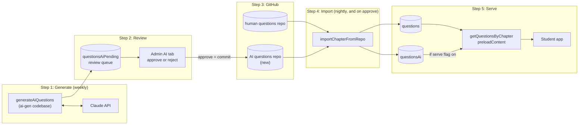
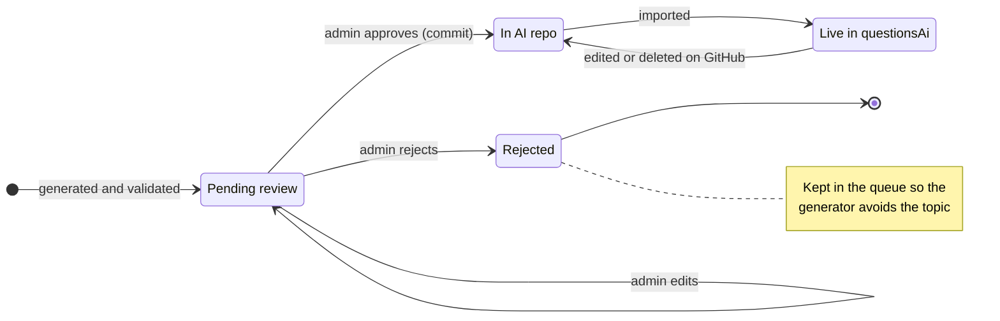
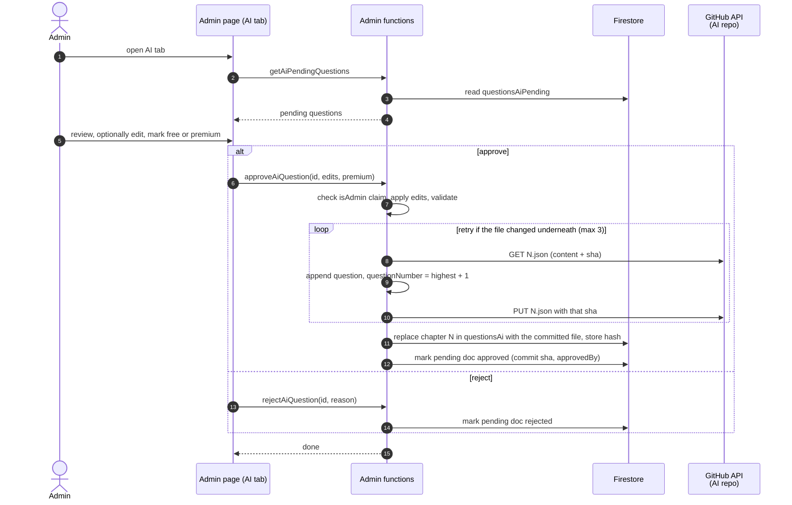
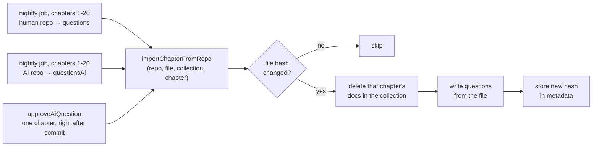
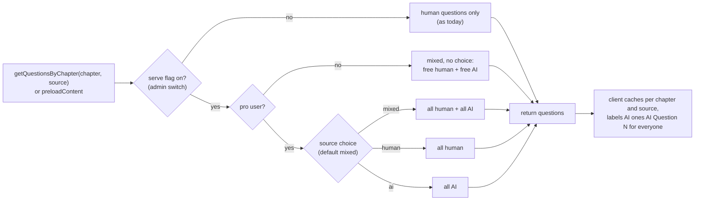

# AI question flow (proposed)

> **Status:** draft design, not built.
>
> The generator half lives in `real-estate-quest-ai-gen` → `docs/ai-question-flow.md` on the `docs/ai-question-flow` branch. The overview and lifecycle diagrams are the same in both repos.

## Principles

- **Repos are the source of truth for anything students see.** Firestore is a copy that can be rebuilt from the repos at any time.
- **`questionsAiPending` is a disposable review queue.** Losing it costs a regeneration, nothing more.
- **AI questions never go into `questions`.** The nightly human import deletes and reimports whole chapters, so anything else in that collection would be wiped.
- **The human questions repo stays read-only everywhere.** Only the new AI repo gets a write token.

## Where things live

There is **one Firebase project**, the existing `real-estate-quest`. There is no separate AI project; the generator, the app, and every collection below live in it.

| | What | Notes |
|---|---|---|
| Firebase project | `real-estate-quest` | The only one. Runs the app, all functions, and Firestore. |
| Functions | `default` codebase from the `real-estate-quest` repo `ai-gen` codebase from the `real-estate-quest-ai-gen` repo | Two repos deploy into the same project. Deploying one never touches the other's functions. |
| Firestore | `questions` (existing), `questionsAi`, `questionsAiPending`, `metadata/aiQuestions` | All in the same database, so no credentials are needed between pieces. |
| GitHub | `real-estate-quest-questions` (existing, human) `real-estate-quest-ai-questions` (new, AI) | Both private. The source of truth for anything students see. |
| External | Claude API | Called only by the generator. |

## Overview

The generator also reads `questions` (few-shot examples) and `questionsAi` (to avoid duplicates); see the generation diagram.

## Question lifecycle

## Review and approve (this repo)

## Nightly import (this repo)

The existing nightly job imports both repos through one shared function, so no new Cloud Scheduler job is needed.

`approveAiQuestion` already has the committed file in hand, so it can skip the fetch and go straight to the replace step.

## Serving (this repo)

- **Pro users** choose Mixed (the default), Human only, or AI only. **Free users** get no choice: the free AI questions are simply mixed in.
- **Mixed** means AI questions come after the human ones; the existing shuffle option mixes them together.
- **Free vs premium** follows the human questions: the reviewer marks each AI question free or premium at approval, premium by default. Today 52 of the 940 human questions are free (about 1 in 18), from 1 in 4 in chapters 2–3 to 1 in 80 in chapters 18–19.

## Changes in this repo

**Functions** ([functions/index.js](../functions/index.js))

- [ ] Pull the body of `importQuestionsFromRepo` into `importChapterFromRepo(repo, file, collection, chapter)` and have the nightly job call it for both repos.
- [ ] New secrets: a fine-grained GitHub token with contents read/write on the AI repo only, plus the AI repo name. The existing `GITHUB_TOKEN` stays read-only.
- [ ] Admin-only callables, checking the `isAdmin` claim like the existing admin functions: `getAiPendingQuestions`, `approveAiQuestion`, `rejectAiQuestion`, `updateAiSettings` (the `generate` and `serve` flags, and `perRun`, the number of questions per weekly run).
- [ ] `getQuestionsByChapter` and `preloadContent`: accept `source` (`mixed`, `human` or `ai`), honour it only for pro users (free users always get mixed), check `metadata/aiQuestions.serve`, merge.
- [ ] Give `questionsAi` the same composite indexes `questions` uses (chapter + premium + questionNumber).
- [ ] Make sure Firestore rules deny direct client access to `questionsAiPending` and `questionsAi`; everything goes through functions.

**Frontend**

- [ ] Admin page ([admin.vue](../src/components/admin.vue), [useAdmin.js](../src/composables/useAdmin.js)): AI tab with the pending list, an edit form, a free/premium choice (premium by default, showing the chapter's current split), approve/reject, the generate/serve switches, the per-run count, and a Generate now button.
- [ ] Options modal ([optionModal.vue](../src/components/optionModal.vue)): a "Question source" choice (Mixed / Human only / AI only, default Mixed) next to "shuffled". Shown only to pro users, and only while the serve flag is on. Changing it clears the question cache.
- [ ] [useQuestion.js](../src/composables/useQuestion.js) and [usePreload.js](../src/composables/usePreload.js): pass `source` and include it in the cache key.
- [ ] [questionCard.vue](../src/components/questionCard.vue): show "AI Question N" (or a badge) for every user, so AI questions are always marked and numbers don't clash with human questions.
- [ ] [useActivityTracker.js](../src/composables/useActivityTracker.js): record `aiGenerated` so stats don't merge AI question 3 with human question 3.
- [ ] Tests for the new composable behaviour in `tests/composables/`.

## Decisions

- **Who sees AI questions:** everyone, always labeled as AI. Pro users choose Mixed (default), Human only, or AI only; free users get them mixed in with no choice.
- **Free vs premium:** the same kind of split as human questions, chosen by the reviewer at approval, premium by default.
- **Volume:** 1–2 questions a week to start, likely 5–10 a week later. One chapter per week, using all of that chapter's questions as context.
- **Rejected questions:** kept, so the generator keeps avoiding those topics. Even at 5–10 a week, each chapter comes up about 2–3 times a year in the 20-week rotation, so it gains at most about 25 AI questions a year, so the context stays small. Revisit if it grows.
- **Notifications:** none. New questions just appear in the review queue on the admin page.
