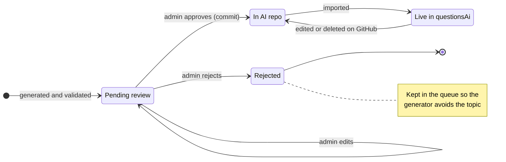
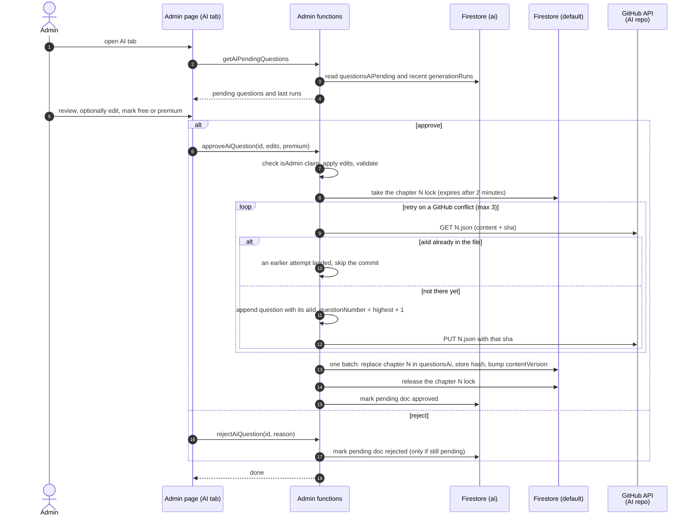
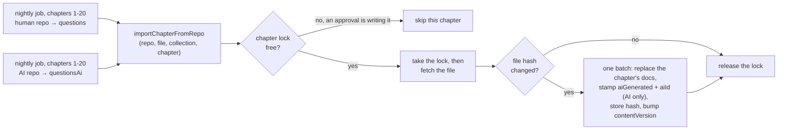
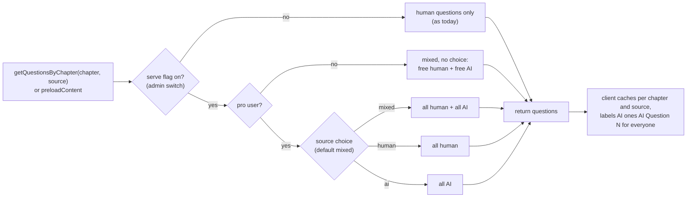

# AI question flow (proposed)

> **Status:** draft design, not built.
>
> The generator half lives in `real-estate-quest-ai-gen` → `docs/ai-question-flow.md`. The principles, where things live, overview and lifecycle sections are the same in both repos.

## Principles

- **Repos are the source of truth for anything students see.** Firestore is a copy that can be rebuilt from the repos at any time.
- **`questionsAiPending` is a disposable review queue.** Losing it costs a regeneration, nothing more.
- **AI questions never go into `questions`.** The nightly human import deletes and reimports whole chapters, so anything else in that collection would be wiped.
- **The human questions repo stays read-only everywhere.** Only the new AI repo gets a write token.
- **The generator can only write to its own database.** It runs as its own service account, which can write the `ai` database and only read `(default)`. A bug in the generator can't change user data, subscriptions or live questions.

## Where things live

There is **one Firebase project**, the existing `real-estate-quest`. There is no separate AI project; the generator, the app, and every collection below live in it. The project has two Firestore databases: `(default)`, which exists today, and a new `ai` one.

| | What | Notes |
|---|---|---|
| Firebase project | `real-estate-quest` | The only one. Runs the app, all functions, and both Firestore databases. |
| Functions | `default` codebase from the `real-estate-quest` repo `ai-gen` codebase from the `real-estate-quest-ai-gen` repo | Two repos deploy into the same project. Deploying one never touches the other's functions. |
| Firestore `(default)` | Everything that exists today (`members`, `questions`, `flashcards`, `study_activity_logs`, ...), plus `questionsAi`, `metadata/aiQuestions` (switches and `perRun`), `metadata/content` (`contentVersion`), `locks/*` (per-chapter locks) | User data lives here. Point-in-time recovery plus the existing weekly backups. |
| Firestore `ai` (new) | `questionsAiPending` (review queue), `generationRuns` (one doc per run, with any error), `locks/generation` | Everything the generator writes, and nothing else. Disposable, so no point-in-time recovery or backups. |
| Service accounts | `ai-gen` (new) runs the `ai-gen` functions The app's functions keep the default one | See Access below. |
| GitHub | `real-estate-quest-questions` (existing, human) `real-estate-quest-ai-questions` (new, AI) | Both private. The source of truth for anything students see. |
| External | Claude API | Called only by the generator. |

### Access

Firestore can't limit server code to certain collections. Security rules work per collection, but they only apply to web and mobile clients; the Admin SDK that Cloud Functions use skips them. IAM does apply to functions, but the smallest thing it can scope to is a whole database. So everything the generator writes goes in its own database, and IAM keeps it there.

| Service account | `(default)` | `ai` |
|---|---|---|
| `ai-gen` (the generator) | read only (`roles/datastore.viewer`) | read and write (`roles/datastore.user`) |
| Default (the app's functions) | read and write | read and write |

- **Each `ai-gen` grant has an IAM condition naming its database,** such as `resource.name == "projects/real-estate-quest/databases/ai"`. A grant without a condition covers every database in the project, which is why the app's functions can already reach both.
- **`ai-gen` also gets the Anthropic key secret, and nothing else.** No GitHub tokens, no Stripe keys.
- **The generator can still read user data in `(default)`.** It can't change or delete it.
- **No keys are involved.** Both databases are in one project, so access is plain IAM.

## Overview

Everything outside Step 1 is in `(default)` except `questionsAiPending`. The generator also reads `questions` (chapter context) and `questionsAi` (to avoid duplicates) from `(default)`, read only; see the generation diagram.

## Question lifecycle

## Review and approve (this repo)

- **Safe to retry.** Every AI question carries a stable `aiId` (its pending doc's id) into the repo file. Say a commit lands but the function dies before updating Firestore, or the admin clicks Approve twice. The next attempt finds the `aiId` already in the file, skips the commit, and only finishes the Firestore step. Nothing is ever appended twice.
- **One writer per chapter.** Approval and import both hold the chapter's lock (a Firestore doc that expires on its own) while they read from GitHub and write `questionsAi`. A slow nightly import can't write an older copy of the file over a newer approval, and two approvals in the same chapter run one after the other instead of racing.
- **All-or-nothing writes.** The chapter's documents, its hash and `contentVersion` go in one batch, so students never see a half-empty chapter. Today's import deletes and re-adds in two separate batches.
- **The pending doc is marked approved last,** as its own write, because a batch can't span two databases. If that write fails, the question is already live, and approving again finishes the job (the `aiId` check skips the commit).

## Nightly import (this repo)

The existing nightly job imports both repos through one shared function, so no new Cloud Scheduler job is needed.

- **The fetch happens after taking the lock,** so the import always writes the newest file, never one it read before an approval landed.
- **Skipping a locked chapter is safe.** The approval holding the lock is already writing the newest version.
- **`approveAiQuestion` writes the chapter itself** from the file it just committed, while it still holds the lock, so it doesn't wait for the nightly run.
- **The importer stamps `aiGenerated: true` and `aiId`** on every `questionsAi` doc itself, rather than trusting whatever is in the file.

## Serving (this repo)

- **Pro users** choose Mixed (the default), Human only, or AI only. **Free users** get no choice: the free AI questions are simply mixed in.
- **Mixed** means AI questions come after the human ones; the existing shuffle option mixes them together.
- **Free vs premium** follows the human questions: the reviewer marks each AI question free or premium at approval, premium by default. Today 52 of the 940 human questions are free (about 1 in 18), from 1 in 4 in chapters 2–3 to 1 in 80 in chapters 18–19.
- **AI questions keep their identity end to end.** `getQuestionsByChapter` returns `aiGenerated` and `aiId` with each AI question, and the activity log stores them. Without that, AI question 3 and human question 3 in a chapter look identical in the logs.

### Turning `serve` off, and the browser cache

The browser caches each chapter's questions for 24 hours (`STALE_TIME`), and a cached chapter never calls the server. On its own, the `serve` switch would take up to a day to reach users.

- **On load, the app calls a small `getContentStatus` callable** that returns `contentVersion` and `aiServe`. If `contentVersion` differs from the cached one, the app clears its question cache.
- **`contentVersion` changes** whenever `serve` is flipped, a question is approved, or an import changes a chapter. So turning `serve` off takes effect on each user's next page load.
- **`aiServe` drives the options modal**, which shows the source choice only when it's on. While it's off, a saved "AI only" choice gets human questions, and the server returns human questions only whatever the client asks for.
- **Side benefit:** edits to human questions stop taking up to a day to show up.

## Changes in this repo

**Functions** ([functions/index.js](../functions/index.js))

- [ ] Pull the body of `importQuestionsFromRepo` into `importChapterFromRepo(repo, file, collection, chapter)` and have the nightly job call it for both repos. It takes the chapter lock before fetching, writes in one batch, stamps `aiGenerated` and `aiId` on AI docs, and bumps `contentVersion` when a chapter changes.
- [ ] New secrets: a fine-grained GitHub token with contents read/write on the AI repo only, plus the AI repo name. The existing `GITHUB_TOKEN` stays read-only.
- [ ] Admin-only callables, checking the `isAdmin` claim like the existing admin functions: `getAiPendingQuestions`, `approveAiQuestion`, `rejectAiQuestion`, `updateAiSettings` (the `generate` and `serve` flags, and `perRun`, the number of questions per weekly run). `approveAiQuestion` holds the chapter lock and skips the commit if the `aiId` is already in the file. Changing `serve` bumps `contentVersion`.
- [ ] A second Firestore client for the `ai` database (`getFirestore(app, "ai")`), used for `questionsAiPending` and `generationRuns`. The app's functions already have access to both databases. `getAiPendingQuestions` also returns the last few `generationRuns`.
- [ ] `getContentStatus` callable returning `contentVersion` and `aiServe`.
- [ ] `getQuestionsByChapter` and `preloadContent`: accept `source` (`mixed`, `human` or `ai`), honour it only for pro users (free users always get mixed), check `metadata/aiQuestions.serve`, merge, and return `aiGenerated` and `aiId` on AI questions.
- [ ] `logStudyActivity`: accept and store `aiGenerated` (boolean) and `aiId` (short string). Its sanitizer keeps only a fixed list of fields today, so anything new from the frontend is silently dropped.
- [ ] Give `questionsAi` the same composite indexes `questions` uses (chapter + premium + questionNumber).
- [ ] Make sure the `(default)` rules deny direct client access to `questionsAi`; everything goes through functions. The `ai` database has its own deny-all rules, deployed from the ai-gen repo.

**Frontend**

- [ ] Admin page ([admin.vue](../src/components/admin.vue), [useAdmin.js](../src/composables/useAdmin.js)): AI tab with the pending list, an edit form, a free/premium choice (premium by default, showing the chapter's current split), approve/reject, the generate/serve switches, the per-run count, recent generation runs with any errors, and a Generate now button that calls `generateAiQuestionsNow` (in the ai-gen codebase).
- [ ] Options modal ([optionModal.vue](../src/components/optionModal.vue)): a "Question source" choice (Mixed / Human only / AI only, default Mixed) next to "shuffled". Shown only to pro users, and only while `aiServe` is on. Changing it clears the question cache.
- [ ] [useQuestion.js](../src/composables/useQuestion.js) and [usePreload.js](../src/composables/usePreload.js): pass `source` and include it in the cache key. Call `getContentStatus` on app load and clear the question cache when `contentVersion` changes.
- [ ] [questionCard.vue](../src/components/questionCard.vue): show "AI Question N" (or a badge) for every user, so AI questions are always marked and numbers don't clash with human questions.
- [ ] [useActivityTracker.js](../src/composables/useActivityTracker.js): send `aiGenerated` and `aiId` with each question event, so stats don't merge AI question 3 with human question 3. This only works together with the `logStudyActivity` change above.
- [ ] Tests for the new composable behaviour in `tests/composables/`.

## Decisions

- **Who sees AI questions:** everyone, always labeled as AI. Pro users choose Mixed (default), Human only, or AI only; free users get them mixed in with no choice.
- **Free vs premium:** the same kind of split as human questions, chosen by the reviewer at approval, premium by default.
- **Volume:** 1–2 questions a week to start, likely 5–10 a week later. One chapter per week, using all of that chapter's questions as context.
- **Rejected questions:** kept, so the generator keeps avoiding those topics. Even at 5–10 a week, each chapter comes up about 2–3 times a year in the 20-week rotation, so it gains at most about 25 AI questions a year, so the context stays small. Revisit if it grows.
- **Notifications:** none. New questions just appear in the review queue on the admin page.
- **Generator access:** its own `ai` database and service account inside this project, not a separate project. It can write only to `ai` and only read `(default)`.
- **Backups:** point-in-time recovery on `(default)` alongside the weekly backups. The `ai` database needs neither.
